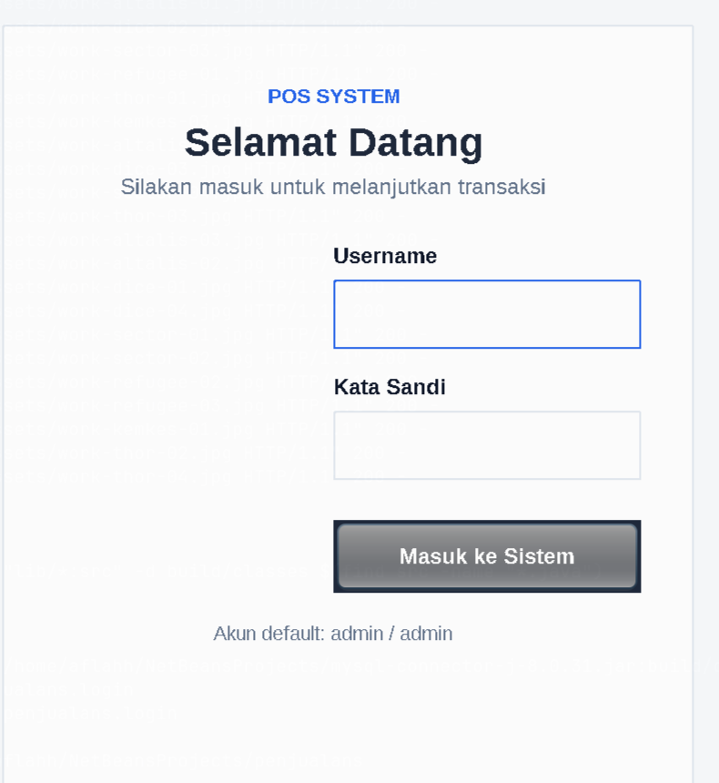
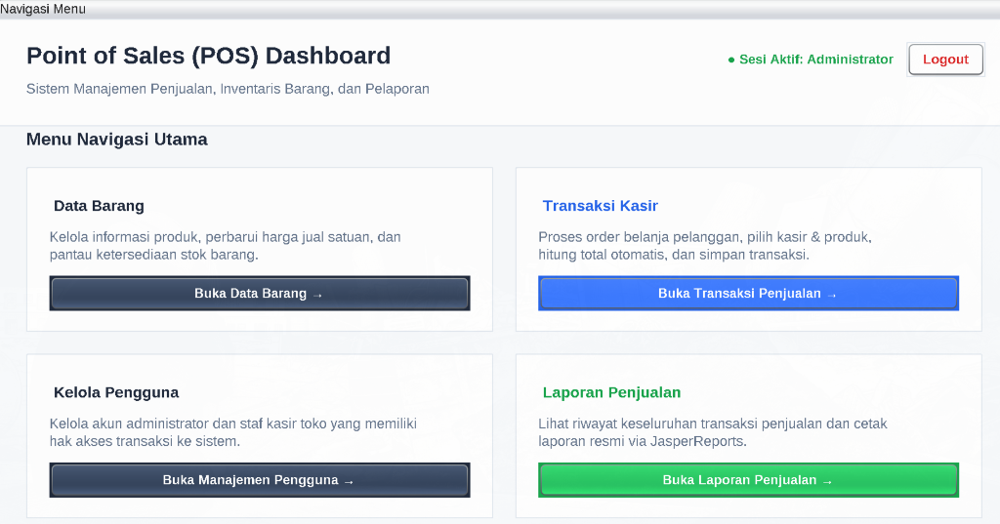
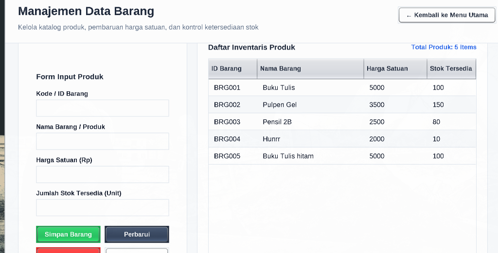
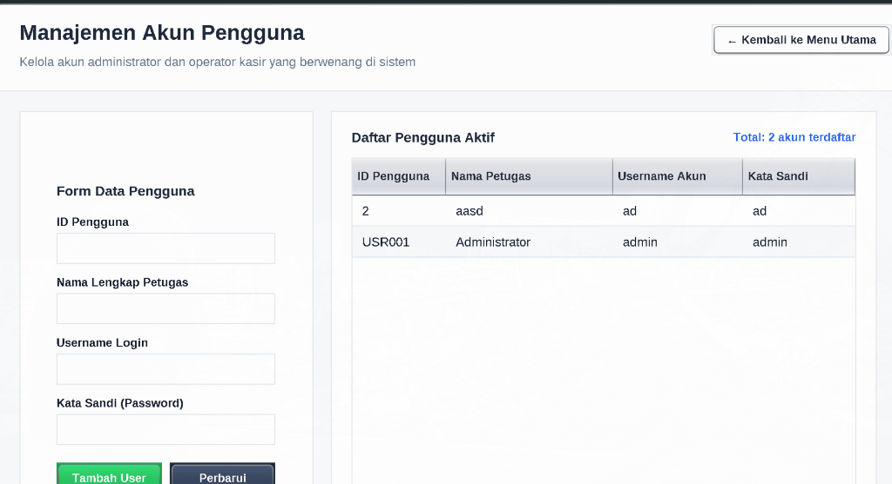
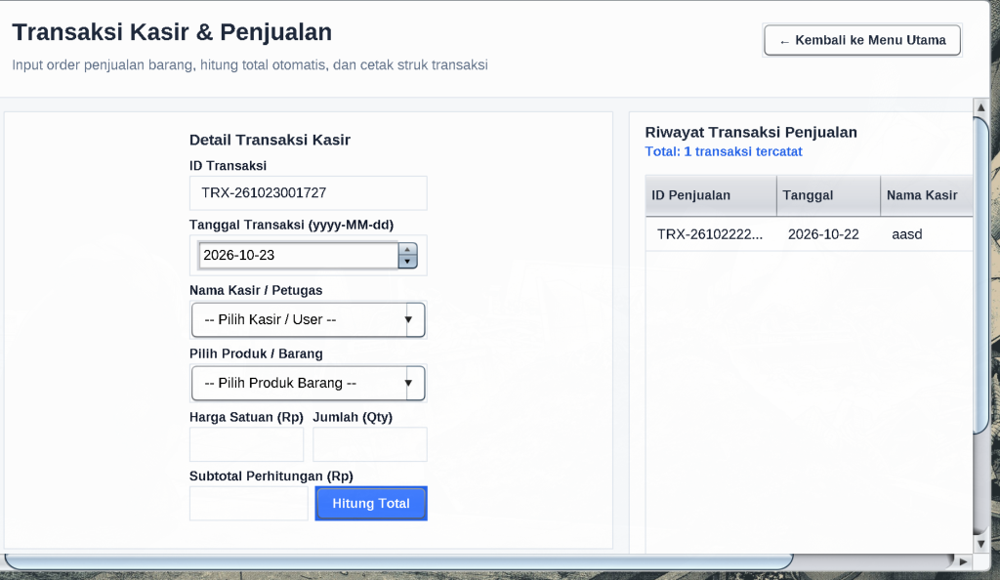

# Point of Sales (POS) Desktop Application with Java Swing and MySQL

Desktop Point of Sales (Kasir dan Manajemen Penjualan) application built with Java Swing and MySQL database. The system handles inventory management, user authentication, transaction recording with automatic totals, and report generation via JasperReports.

---

## User Interface and Feature Preview

### 1. Authentication (`login.java`)
Centered authentication card with masked password entry (`JPasswordField`), input validation, and default administrator credentials (`admin / admin`).



### 2. Main Executive Dashboard (`menu.java`)
Navigation center displaying active session status (`● Sesi Aktif: Administrator`), quick logout, and module shortcut cards for inventory, cashier transactions, user administration, and sales reporting.



### 3. Inventory Management (`barang.java`)
Dual-card layout separating product input fields (Kode / ID Barang, Nama Barang, Harga Satuan, Jumlah Stok) from the live inventory catalog table with real-time item counter.



### 4. User Account Administration (`user.java`)
Cashier and administrator credential management featuring user creation, updates, password management, and active user registry table.



### 5. Cashier Checkout and Sales Transactions (`penjualan.java`)
Transaction register featuring real-time total billing display, auto-generated transaction IDs, cashier and product dropdown selection, unit quantity multipliers, smooth-scrolling transaction history, and receipt printing.



---

## 1. System Requirements

Ensure the following software is installed on the host machine:

| Component | Minimum Version | Recommended Version |
| :--- | :--- | :--- |
| **Java Development Kit (JDK)** | OpenJDK 8 / Oracle JDK 8 | OpenJDK 11, 17, or 21 |
| **Relational Database** | MySQL 5.7 / MariaDB 10.3 | MySQL 8.0+ |
| **Build Tool (Optional)** | Apache Ant 1.10+ | Bundled with NetBeans |
| **IDE (Optional)** | Apache NetBeans 12.0+ | Apache NetBeans 18+ |
| **Operating System** | Linux, Windows 10/11, macOS | Any OS with Java Desktop Support |

---

## 2. Bundled Libraries

All third-party dependencies are pre-bundled in the `lib/` directory:

| JAR File | Purpose |
| :--- | :--- |
| `mysql-connector-j-8.0.31.jar` | JDBC driver for MySQL database connectivity |
| `jasperreports.jar` (v6.20.0) | Reporting engine for sales document generation and preview |
| `groovy-3.0.19.jar` | Groovy expression compiler runtime required by JasperReports |
| `commons-collections4-4.4.jar` | Collection utilities required by JasperReports 6.x |
| `commons-beanutils-1.9.4.jar` | Property introspection used by JasperReports |
| `commons-collections-3.2.2.jar` | Legacy collection support for JasperReports components |
| `commons-digester-2.1.jar` | XML rule-based parser for `.jrxml` templates |
| `commons-logging-1.2.jar` | Logging facade used across Jakarta Commons libraries |
| `jcalendar-1.4.jar` | Date picker component library |

---

## 3. Database Installation and Configuration

### 3.1 Connection Parameters

The application connects using the following default configuration across all modules:

- **Host**: `localhost`
- **Port**: `3306`
- **Database Name**: `program_aplikasi`
- **Username**: `root`
- **Password**: `` (blank)
- **JDBC URL**: `jdbc:mysql://localhost:3306/program_aplikasi`

### 3.2 Schema Initialization

#### Option A: Using MySQL Command Line

Run the following commands in terminal or command prompt:

```bash
# 1. Log in and create database
mysql -u root -p -e "CREATE DATABASE IF NOT EXISTS program_aplikasi;"

# 2. Import database schema and initial data
mysql -u root -p program_aplikasi < database.sql
```

If your local MySQL root user has no password, omit the `-p` flag:

```bash
mysql -u root -e "CREATE DATABASE IF NOT EXISTS program_aplikasi;"
mysql -u root program_aplikasi < database.sql
```

#### Option B: Using phpMyAdmin (XAMPP / Laragon / WampServer)

1. Open `http://localhost/phpmyadmin` in your web browser.
2. Click **New** in the left sidebar.
3. Enter database name `program_aplikasi` and click **Create**.
4. Select `program_aplikasi`, navigate to the **Import** tab.
5. Click **Choose File**, select `database.sql` from this project directory.
6. Click **Import** at the bottom of the page.

#### Option C: Using Docker

To run an isolated MySQL container with the project schema preloaded:

```bash
docker run --name pos-mysql \
  -e MYSQL_ALLOW_EMPTY_PASSWORD=yes \
  -e MYSQL_DATABASE=program_aplikasi \
  -v $(pwd)/database.sql:/docker-entrypoint-initdb.d/init.sql:ro \
  -p 3306:3306 \
  -d mysql:8.0
```

### 3.3 Default Credentials

Once the database is imported, the default administrator account is available:

- **Username**: `admin`
- **Password**: `admin`

---

## 4. Project Directory Structure

```
.
├── database.sql                  # Database creation script and seed records
├── docs/                         # Documentation assets and screenshots
│   └── screenshots/
│       ├── 01_login.png
│       ├── 02_dashboard.png
│       ├── 03_data_barang.png
│       ├── 04_kelola_pengguna.png
│       └── 05_transaksi_kasir.png
├── lib/                          # Bundled runtime dependencies (.jar)
│   ├── commons-beanutils-1.9.4.jar
│   ├── commons-collections-3.2.2.jar
│   ├── commons-collections4-4.4.jar
│   ├── commons-digester-2.1.jar
│   ├── commons-logging-1.2.jar
│   ├── groovy-3.0.19.jar
│   ├── jasperreports.jar
│   ├── jcalendar-1.4.jar
│   └── mysql-connector-j-8.0.31.jar
├── src/
│   ├── jasperreports.properties  # Global JasperReports configuration
│   └── penjualans/
│       ├── UITheme.java          # Centralized UI styling, fonts, and colors
│       ├── ReportService.java    # Safe JasperReports wrapper and viewer
│       ├── login.java            # Authentication window
│       ├── menu.java             # Main dashboard navigation window
│       ├── barang.java           # Inventory management window
│       ├── user.java             # User account management window
│       ├── penjualan.java        # Cashier checkout and transaction window
│       ├── laporan.java          # Sales reporting and KPI metrics window
│       ├── reportPenjualan.jrxml # Source report layout template (XML)
│       └── reportPenjualan.jasper# Compiled binary report template
├── nbproject/                    # NetBeans project configuration
├── build.xml                     # Apache Ant build script
└── README.md
```

---

## 5. Build and Run Instructions

### 5.1 Command Line (Linux / macOS)

From the project root directory:

```bash
# 1. Create build output directory
mkdir -p build/classes

# 2. Compile Java source files against bundled libraries
javac -cp "lib/*:src" -d build/classes $(find src -name "*.java")

# 3. Copy runtime resources to class output directory
cp src/penjualans/*.jasper build/classes/penjualans/ 2>/dev/null || true
cp src/penjualans/*.jrxml build/classes/penjualans/ 2>/dev/null || true
cp src/jasperreports.properties build/classes/ 2>/dev/null || true

# 4. Launch the application (starts at Login screen)
java -cp "lib/*:build/classes" penjualans.login
```

### 5.2 Command Line (Windows PowerShell)

```powershell
# 1. Create build directory
New-Item -ItemType Directory -Force -Path build\classes

# 2. Compile Java sources
$sources = Get-ChildItem -Path src -Recurse -Filter *.java | ForEach-Object { $_.FullName }
javac -cp "lib/*;src" -d build/classes $sources

# 3. Copy resources
Copy-Item src\penjualans\*.jasper -Destination build\classes\penjualans\ -Force -ErrorAction SilentlyContinue
Copy-Item src\penjualans\*.jrxml -Destination build\classes\penjualans\ -Force -ErrorAction SilentlyContinue
Copy-Item src\jasperreports.properties -Destination build\classes\ -Force -ErrorAction SilentlyContinue

# 4. Execute application
java -cp "lib/*;build/classes" penjualans.login
```

### 5.3 Apache NetBeans IDE

1. Open NetBeans IDE.
2. Select **File** > **Open Project**.
3. Browse to and select the `penjualans` directory.
4. NetBeans will detect the project using `nbproject/project.properties` (libraries in `lib/` are configured via relative paths).
5. Ensure MySQL is running locally.
6. Right-click the project node and select **Clean and Build**.
7. Right-click `login.java` inside package `penjualans` and select **Run File** (or press `Shift + F6`).

---

## 6. Application Workflow

1. **Authentication (`login.java`)**:
   - Enter `admin` / `admin`.
   - Press **Enter** or click **Masuk ke Sistem**.
2. **Main Dashboard (`menu.java`)**:
   - Provides status monitoring and one-click navigation to all four operational modules:
     - **Data Barang**: Manage product catalogs, unit prices, and stock counts.
     - **Transaksi Kasir**: Process customer purchases, choose cashier and items, compute subtotals, and record transactions.
     - **Kelola Pengguna**: Register and administer cashier and manager accounts.
     - **Laporan Penjualan**: View revenue summary cards (Total Transaksi, Total Omset, Total Barang Terjual) and export printable reports.
3. **Receipt & Report Generation**:
   - Clicking **Cetak Struk** on the transaction window or **Cetak Dokumen JasperReports** on the report window opens the interactive JasperReports viewer.
   - The viewer supports zooming, printing to local printers, and exporting to PDF, XLS, CSV, or HTML.

---

## 7. Configuration Details

### 7.1 Changing Database Credentials

If your local MySQL setup uses a password or a different port, update the connection strings in the source files:

- `src/penjualans/login.java`
- `src/penjualans/penjualan.java`
- `src/penjualans/barang.java`
- `src/penjualans/user.java`
- `src/penjualans/laporan.java`
- `src/penjualans/ReportService.java`

Format:
```java
Connection con = DriverManager.getConnection("jdbc:mysql://<HOST>:<PORT>/<DATABASE>", "<USERNAME>", "<PASSWORD>");
```

Example for user `root` with password `secret` on port `3306`:
```java
Connection con = DriverManager.getConnection("jdbc:mysql://localhost:3306/program_aplikasi", "root", "secret");
```

### 7.2 JasperReports Configuration

The file `src/jasperreports.properties` defines engine parameters:

```properties
net.sf.jasperreports.awt.ignore.missing.font=true
```

This ensures that report generation falls back gracefully to system standard fonts on platforms where proprietary Microsoft Windows fonts (such as Times New Roman) are not installed.

---

## 8. Troubleshooting

### Problem: `CommunicationsException: Communications link failure`
- **Cause**: The application cannot connect to MySQL at `localhost:3306`.
- **Solution**:
  1. Check if the MySQL server is active:
     - Linux: `sudo systemctl status mysql` or `sudo systemctl status mariadb`
     - Windows: Open Services (`services.msc`) and verify `MySQL` / `MariaDB` service status.
  2. Verify that MySQL is listening on port 3306:
     ```bash
     netstat -tlpn | grep 3306
     ```

### Problem: `Access denied for user 'root'@'localhost'`
- **Cause**: MySQL root user requires a password, but the code passes an empty string `""`.
- **Solution**: Update the password argument in the `DriverManager.getConnection` calls across the source files, or grant passwordless access for local root connections:
  ```sql
  ALTER USER 'root'@'localhost' IDENTIFIED WITH mysql_native_password BY '';
  FLUSH PRIVILEGES;
  ```

### Problem: `Table 'program_aplikasi.user' doesn't exist`
- **Cause**: The database exists but the tables were not imported.
- **Solution**: Re-import `database.sql`:
  ```bash
  mysql -u root -p program_aplikasi < database.sql
  ```

### Problem: `JRFontNotFoundException`
- **Cause**: Host operating system lacks the font requested by JasperReports.
- **Solution**: `reportPenjualan.jrxml` is configured to use universal `SansSerif` fonts, and `jasperreports.properties` enables `net.sf.jasperreports.awt.ignore.missing.font=true`. Ensure `jasperreports.properties` is present in `build/classes/`.

### Problem: Window clipping on small laptop screens
- **Cause**: Display resolution lower than 1366x768.
- **Solution**: All modules are wrapped in smooth-scrolling `JScrollPane` containers and window resizing (`setResizable(true)`) is enabled. Use the mouse wheel or maximize the window to reveal all form inputs and action buttons.

---

## 9. License

This repository is maintained for educational and professional demonstration purposes.
